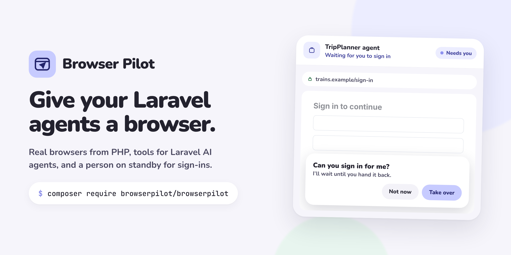
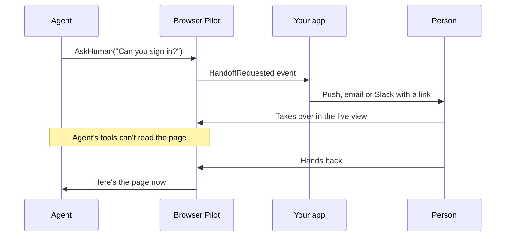

<p align="center">
  
</p>

<p align="center">
  <a href="https://packagist.org/packages/browserpilot/browserpilot"></a>
  <a href="https://github.com/addtobag/browserpilot/actions/workflows/tests.yml"></a>
  <a href="https://packagist.org/packages/browserpilot/browserpilot"></a>
  <a href="LICENSE.md"></a>
</p>

<p align="center">
  <b>Real browsers from PHP. Tools for Laravel AI agents. A person on standby when a site needs a sign-in.</b>
</p>

<p align="center">
  <a href="#installation">Installation</a> ·
  <a href="#give-an-agent-a-browser">Agents</a> ·
  <a href="#human-take-over">Take-over</a> ·
  <a href="#drivers">Drivers</a> ·
  <a href="#testing">Testing</a>
</p>

---

## Why Browser Pilot?

Lots of useful work is stuck behind a sign-in on a site with no API: supplier portals, booking sites, old admin panels. AI agents can drive a browser, but they get stuck at exactly the moments that matter, like a password, a two-factor code, a CAPTCHA or a payment.

Browser Pilot gives your Laravel app:

- **A browser you can drive from PHP.** Open pages, click, type, read and screenshot.
- **Agent tools for the [Laravel AI SDK](https://laravel.com/docs/ai-sdk).** Add two lines to any agent.
- **Human take-over.** The agent asks for help, a person steps into a live view, then hands back.
- **Saved logins.** People sign in once and agents stay signed in.
- **Any provider.** Pilot Cloud, Browserbase, Steel or Chrome on your own machine. Switch in one line.
- **`Pilot::fake()`.** Tests that never open a real browser.

## Installation

```bash
composer require browserpilot/browserpilot
php artisan pilot:install
```

`pilot:install` publishes `config/pilot.php` and the migrations, and offers to run them. Then choose where your browsers run:

```env
PILOT_DRIVER=browserbase          # pilot, browserbase, steel or local
BROWSERBASE_API_KEY=
BROWSERBASE_PROJECT_ID=
```

Requires PHP 8.2+ and Laravel 12 or 13. Install `laravel/ai` for the agent tools and `livewire/livewire` for the live view.

## Give an agent a browser

```php
use BrowserPilot\Facades\Pilot;
use Laravel\Ai\Contracts\Agent;
use Laravel\Ai\Contracts\HasTools;
use Laravel\Ai\Promptable;

class TripPlanner implements Agent, HasTools
{
    use Promptable;

    public function instructions(): string
    {
        return 'You book train tickets. Ask a person to sign in or pay.';
    }

    public function tools(): iterable
    {
        return [
            ...Pilot::tools(),   // Browse, Click, TypeText, ReadPage, Screenshot
            Pilot::handoff(),    // AskHuman: a person takes over, then hands back
        ];
    }
}

(new TripPlanner)->prompt('Book the 9:40 to London');
```

The agent sees each page as a short, numbered list of links, buttons and fields plus the page text, so it can say "click 12" instead of guessing CSS selectors. Values typed into fields are never sent back to the model.

Without a session, the tools share one browser that starts the first time the agent uses it and is released when the request or queued job finishes. To control a specific browser, for example one your user is watching, pass it in:

```php
$session = Pilot::session()
    ->profile("user-{$user->id}-trainline")
    ->for($user)
    ->start();

$tools = [...Pilot::tools($session), Pilot::handoff($session)];
```

> [!TIP]
> Agents that can ask for help wait for a person, so run them on a queue.

## Drive a browser yourself

```php
$session = Pilot::session()
    ->profile('acme-portal')       // saved login
    ->region('eu-central-1')
    ->timeout(600)
    ->start();

$page = $session->page()->goto('https://portal.acme.test/invoices');

$page->type('#search', 'October')->press('Enter');
$page->click('a.download');

$data = $page->extract(['total' => '.total', 'due' => '.due-date']);
$path = $page->screenshot();

$session->release();
```

## Human take-over

When an agent calls `AskHuman`, or you call `$session->requestHandoff()`, Browser Pilot pauses the agent and waits for a person.



Tell people when they're needed:

```php
use BrowserPilot\Events\HandoffRequested;

Event::listen(function (HandoffRequested $event) {
    // $event->session, $event->reason
    // Send a notification linking to your live view page.
});
```

Drop the live view into any Livewire page:

```blade
<livewire:pilot-live-view :session="$session" />
```

It's watch-only while the agent works, and becomes usable when the agent asks for help or the person presses **Take over**. Set `pilot.live_view.gate` to a Gate ability to control who can see it.

## Saved logins

Pass a profile name and Browser Pilot keeps the browser's cookies and storage between sessions:

```php
Pilot::session()->profile('acme-portal')->start();
```

The first time, a person signs in through take-over. After that, agents start already signed in. Profiles are Browserbase contexts on the `browserbase` driver, Pilot Cloud saved logins on `pilot`, and a Chrome user data directory on `local`.

## Drivers

| Driver | Live view and take-over | Saved logins | Set up |
|---|:---:|:---:|---|
| `pilot` | ✓ | ✓ | `PILOT_API_KEY` from Pilot Cloud |
| `browserbase` | ✓ | ✓ | `BROWSERBASE_API_KEY`, `BROWSERBASE_PROJECT_ID` |
| `steel` | ✓ | Not yet | `STEEL_API_KEY` (Steel Cloud or self-hosted) |
| `local` | – | ✓ | Chrome or Chromium installed; `CHROME_PATH` if it isn't found |

Add your own by implementing `BrowserPilot\Contracts\Driver`:

```php
Pilot::extend('mine', fn ($app) => new MyDriver);
```

Every driver talks to the browser over the Chrome DevTools Protocol, using [chrome-php/chrome](https://github.com/chrome-php/chrome).

## Events

| Event | When |
|---|---|
| `SessionStarted` | A browser starts |
| `HandoffRequested` | An agent or person asks for a human |
| `HandedBack` | The person gives control back |
| `SessionReleased` | The browser is stopped |

## Testing

```php
use BrowserPilot\Facades\Pilot;

it('fetches the latest invoice', function () {
    $fake = Pilot::fake([
        'https://portal.acme.test/*' => 'Invoice INV-1001 £120.00',
    ]);

    (new InvoiceFetcher)->prompt('Get the latest invoice');

    $fake->assertVisited('https://portal.acme.test/*');
    $fake->assertHandoffRequested('sign in');
    $fake->assertReleased();
});
```

The fake hands control back straight away. Call `->holdHandoffs()` to keep handoffs waiting.

| Assertion | |
|---|---|
| `assertSessionStarted(?Closure)` | A session started (optionally matching its options) |
| `assertSessionsStarted(int)` | Exactly this many sessions started |
| `assertNothingStarted()` | No browser was opened |
| `assertVisited(string)` / `assertNotVisited(string)` | URLs, with `*` wildcards |
| `assertClicked(string)` | A selector was clicked |
| `assertTyped(string, ?string)` | Text was typed, optionally into a selector |
| `assertHandoffRequested(?string)` / `assertNoHandoffRequested()` | Take-over was (or wasn't) requested |
| `assertReleased()` | Every session was released |

## Configuration

`config/pilot.php` covers the default driver, provider keys, session timeout and viewport, how long agents wait for a person, how much page text tools send to the model, and the live view gate. Every option is commented.

## Security

- While a person is in control, agent tools refuse to read the page.
- Page reads never include what's typed into fields.
- Browser connection URLs are stored encrypted.
- `TypeText` tells the model to hand passwords, card numbers and one-time codes to a person instead.

Found a vulnerability? Please report it privately through [GitHub security advisories](https://github.com/addtobag/browserpilot/security/advisories/new), not a public issue.

## Fair use

Browser Pilot is for automating work people are entitled to do, like their own accounts, their own suppliers and their own systems. Please don't use it for ticket or sneaker bots, credential stuffing, mass account creation, or scraping that breaks a site's terms.

## Contributing

Bug reports and pull requests are welcome. See [CONTRIBUTING.md](CONTRIBUTING.md).

```bash
composer install
composer test
```

## Changelog

See [CHANGELOG.md](CHANGELOG.md).

## Licence

MIT. See [LICENSE.md](LICENSE.md).

---

<p align="center">
  <sub>Made by <a href="https://github.com/addtobag">Addtobag</a>. Browser Pilot is an independent project and is not affiliated with Laravel.</sub>
</p>
